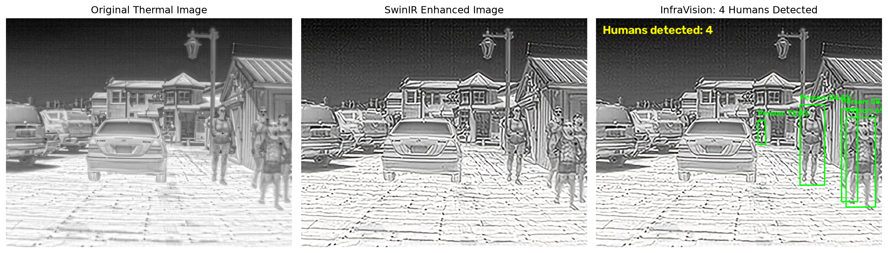

# InfraVision

InfraVision is a PyTorch research project for thermal (infrared) imagery. It
enhances a thermal image and detects the people in it, with an optional
thermal-to-colour translation step.



## Pipeline

| Stage | Folder | Model | Role |
|---|---|---|---|
| Enhancement | `SR/` | EDSR and a SwinIR-style refinement network | Restores detail in degraded thermal images |
| Person detection | `human_detection/` | YOLO11s (Ultralytics) | Finds people in thermal images |
| Colorization | `colorization/` | CycleGAN | Translates single-channel thermal into RGB (standalone) |

`integrate_infravision.py` ties the first two together:

1. Loads a thermal test image.
2. Enhances it with SwinIR. The enhanced image is used **for display only**.
3. Runs YOLO on the **original** thermal image. YOLO was trained on raw
   thermal frames, and feeding it the SwinIR output roughly halved recall in
   testing.
4. Draws the detections on the enhanced image and saves the results to
   `integrated_outputs/`.

Colorization is not wired into the integrated script yet; run it on its own
(see below).

## Repository layout

```
InfraVision/
├── integrate_infravision.py   # end-to-end demo: enhance + detect
├── integrated_outputs/        # demo results
├── SR/                        # super-resolution / enhancement
│   ├── models/                # edsr.py, swinir_refine.py
│   ├── prepare_dataset.py     # DIV2K degradation pairs
│   ├── prepare_pop_dataset.py # POP thermal degradation pairs
│   ├── train*.py              # EDSR, SwinIR and EDSR+Swin training variants
│   └── evaluate*.py, test*.py # PSNR / SSIM evaluation
├── human_detection/           # YOLO11s person detection
│   ├── datasets/              # convert_flir.py, convert_pop.py (COCO -> YOLO)
│   ├── organize_dataset.py    # builds thermal_person train/val/test split
│   ├── train.py, detect.py, evaluate.py
│   └── data.yaml
├── colorization/              # CycleGAN thermal -> RGB
│   ├── train_cyclegan.py
│   └── colorize.py
└── colab_training/            # Colab / Kaggle notebooks for long YOLO runs
```

## Installation

Python 3.10+ is recommended. A CUDA GPU is strongly recommended for training;
the demo also runs on CPU.

```bash
git clone https://github.com/elzasabu/InfraVision.git
cd InfraVision
python -m venv .venv
source .venv/bin/activate          # Windows: .venv\Scripts\activate

# PyTorch: pick the command for your CUDA version from https://pytorch.org
pip install torch torchvision

pip install ultralytics opencv-python pillow numpy matplotlib tqdm scikit-image
```

The Colab notebooks pin `ultralytics==8.4.177`; use the same version if you
want results that match the trained weights exactly.

> **Note:** the committed `requirements.txt` is UTF-16 encoded, includes many
> packages this project does not use, and is missing `ultralytics` and
> `opencv-python`. Use the commands above until it is cleaned up.

## Model weights and datasets

Weights (`*.pt`, `*.pth`) and datasets are excluded by `.gitignore`, so a
fresh clone cannot run anything until you put them in place. Paths below are
relative to the repository root.

### Weights

| File | Used by | Produced by |
|---|---|---|
| `human_detection/runs/thermal/colab_resumed/weights/best.pt` | `integrate_infravision.py` | `colab_training/train_thermal_yolo_colab.ipynb` (FLIR thermal, training resumed on Colab) |
| `human_detection/runs/pop/baseline/weights/best.pt` | `human_detection/detect.py` | `human_detection/train.py` (POP) |
| `SR/checkpoints/swinir_direct/swinir_direct_epoch_20.pth` | `integrate_infravision.py` | `SR/train_swinir.py` |
| `colorization/checkpoints/cyclegan/colorizer_G_AB.pth` | `colorization/colorize.py` | `colorization/train_cyclegan.py` |

`SR/train_swinir.py` writes its checkpoints to
`SR/checkpoints_pop/swinir_direct/`, but the integrated script reads from
`SR/checkpoints/swinir_direct/`. Copy or move the epoch-20 checkpoint across
after training.

`yolo11s.pt` (the pretrained starting point for `human_detection/train.py`) is
downloaded automatically by Ultralytics.

### Datasets

| Path | Contents | Source |
|---|---|---|
| `POP/{train,test}/JPEGImages/` and `POP/{train,test}/Annotations/{split}.json` | POP drone thermal images with COCO annotations | POP dataset |
| `human_detection/datasets/flir_align/` | `thermal/{train,test}/`, `visible/{train,test}/`, `coco_annotations/` | FLIR ADAS aligned (thermal + visible pairs) |
| `SR/dataset/DIV2K_train_HR/` | DIV2K high-resolution images (optional, for the original SR experiments) | DIV2K |

Derived datasets are generated from these with the scripts below.

## Preparing data

```bash
# FLIR: COCO -> YOLO labels, then a train/val/test split for the demo
python human_detection/datasets/convert_flir.py      # -> flir_align/labels/train/
python human_detection/organize_dataset.py          # -> datasets/thermal_person/

# POP: COCO -> YOLO dataset for detection
python human_detection/datasets/convert_pop.py      # -> datasets/pop/

# POP: degraded/clean pairs for super-resolution (run from SR/)
cd SR && python prepare_pop_dataset.py && cd ..     # -> SR/dataset_pop/
```

The SR and colorization scripts use paths relative to their own folder, so run
them from inside `SR/` or `colorization/`.

## Running the integrated demo

With the two weights files and `human_detection/datasets/thermal_person/images/test/`
in place:

```bash
python integrate_infravision.py
```

It picks the 201st image (sorted by name) from the test folder; change
`input_path` near the top of section 6 to use a different image. Outputs are
written to `integrated_outputs/`:

- `enhanced_thermal.png`: SwinIR output
- `infravision_final.png`: enhanced image with person boxes and count
- `infravision_comparison.png`: original, enhanced and detection side by side

Detection uses `imgsz=640`, `conf=0.25` and `iou=0.5`.

## Training and evaluating each stage

**Super-resolution** (from `SR/`):

```bash
python train_swinir.py        # SwinIR refinement on dataset_pop
python train_edsr_swin.py     # EDSR + Swin variant
python evaluate_swinir_direct.py
```

**Person detection** (from the repo root):

```bash
python human_detection/train.py      # YOLO11s on POP, 50 epochs, imgsz 640
python human_detection/detect.py     # run the POP model on test images
python human_detection/evaluate.py
```

For longer runs, use the notebooks in `colab_training/` (Colab or Kaggle GPU).
They expect the zipped dataset in Google Drive or as a Kaggle input.

**Colorization** (from `colorization/`):

```bash
python train_cyclegan.py --epochs 100 --batch 2 --size 256
python colorize.py path/to/thermal.jpg --out colorized.png
```

Training uses unpaired POP thermal images and FLIR visible images, plus an
optional supervised loss on aligned FLIR pairs (`--paired_weight`).
