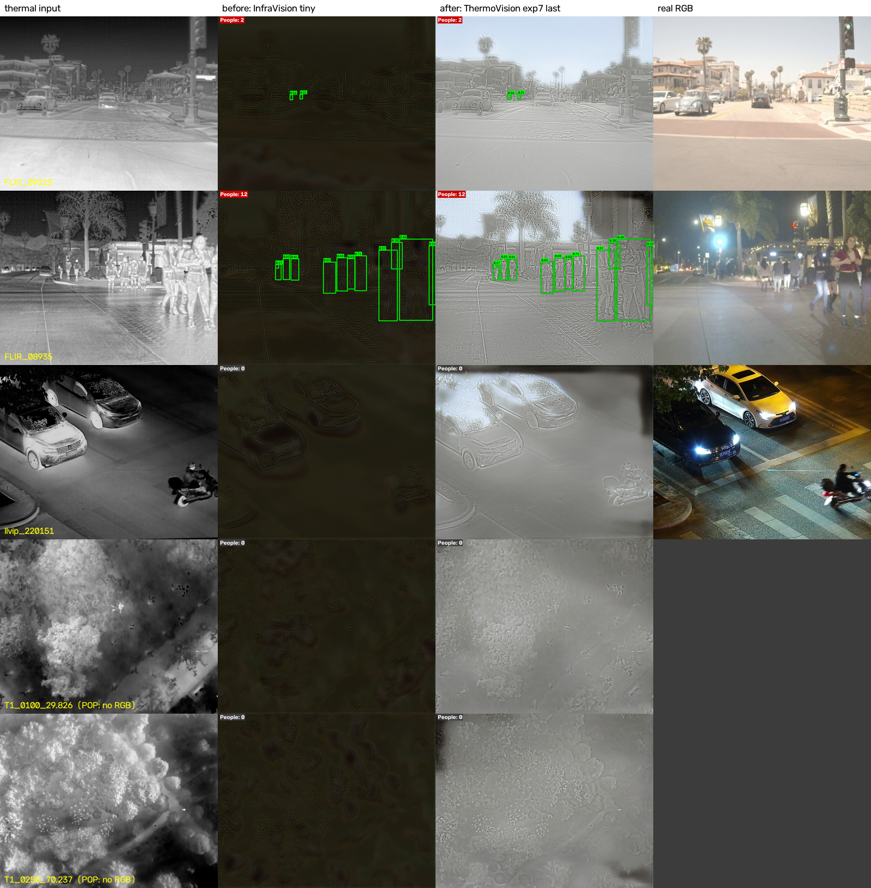
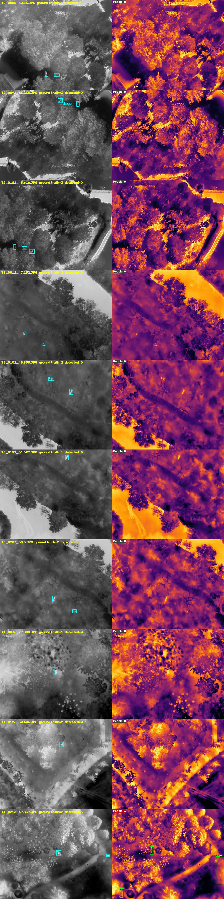

# InfraVision results

Status on 2026-10-29: the full pipeline runs end to end on CPU, but **none of
the three models has been trained on its target data yet** (that needs a GPU,
see `notebooks/train_colab.ipynb`). The numbers below are the *starting
point*: baselines and the older models that were already in the repo. Re-run
the commands at the bottom after Colab training to fill in the real numbers.

All numbers come from `docs/results/metrics.json` and the commands listed at
the end. CPU: 4 threads, no GPU.

## Detection: YOLO on POP (primary dataset)

Model: `human_detection/runs/thermal/colab_resumed/weights/best.pt`, YOLO11s
trained on **FLIR street-level** thermal, not on POP. POP val, flights
F13-F16, 200 evenly spaced frames, 597 people, IoU 0.5.

| imgsz | tiling | mAP@0.5 | precision | recall | s / image |
|---|---|---|---|---|---|
| 640 | none | 0.013 | 0.26 | 0.010 | 0.14 |
| 640 | 2x2 | 0.036 | 0.18 | 0.049 | 0.62 |
| **1024 (config default)** | none | **0.037** | **0.34** | **0.040** | 0.28 |
| 1024 | 2x2 | 0.065 | 0.12 | 0.089 | 1.31 |
| 1280 | none | 0.043 | 0.25 | 0.047 | 0.38 |
| 1280 | 2x2 | 0.043 | 0.06 | 0.085 | 2.28 |

Precision and recall at conf 0.25. Recall by person size (box side) at
1024 / 2x2 tiles: 16-32 px 0.025, 32-64 px 0.12, 64+ px 0.03.

What this says: the FLIR model does not transfer to POP's drone view (people
are ~40 px seen from 30-55 m above). A larger input and tiling help a little,
which confirms small objects are the problem, but the real fix is training on
POP. The config keeps imgsz 1024 and no tiling until the POP model exists;
re-run the size/tiling sweep then, since tiling may help it more.

## Detection v2: POP + flood v2 + AIResQ + WiSARD (Kaggle U9, 2026-11-01)

`checkpoints/yolo/sar_v2.pt`, fine-tuned from the POP model on 11.6k frames
(`human_detection/sar_yolo.zip`, `colab_training/train_sar_yolo_kaggle.ipynb`). Test sets are
flights / sequences never used for training. mAP@0.5 from the notebook (`results/detection_sar_v2_eval.json`):

| test set | POP model (before) | **v2** |
|---|---|---|
| POP test (900 frames) @1024 | 0.620 | 0.614 |
| POP test, synthetic flood @1024 | 0.975 | 0.955 |
| AIResQ, 4 held-out flights (468) @640 / @1024 | 0.041 / 0.147 | **0.325 / 0.396** |
| WiSARD, 4 held-out sequences (2547) @640 / @1024 | 0.224 / 0.268 | **0.469 / 0.630** |
| empty water blobs detected as people (conf 0.25) | 26.8% | **2.7%** (gate < 2%) |

- POP stays level while the new domains improve 2.4-2.7x; the flood shortcut is almost gone.
- Training stopped at epoch 10 with the best val epoch = 2: val was ~80% POP frames, so model
  selection followed POP. v3 uses a balanced val (every 4th POP val frame) and a gentler fine-tune
  (SGD lr 0.002, cosine).
- Large, close, oblique people (low drone, 150-300 px tall) are still missed (1 of 4 on a test
  frame; stock COCO YOLO finds 4/4). The dashboard therefore adds the COCO model for large boxes
  only (`detection.near_weights`): 4/4 on that frame, no change on POP / HIT-UAV / RGBT (A/B on
  100-150 frames each). v3 adds LLVIP persons to train it in.
- New thermal sets, current (POP) model: HIT-UAV test 0.262, RGBTDronePerson val 0.055 @640 / 0.076 @1024.

## Detection v3: + RGBTDronePerson, HIT-UAV, LLVIP persons (Kaggle U10, 2026-11-01)

`checkpoints/yolo/sar_v3.pt`, fine-tuned from v2 (balanced val, SGD lr 0.002 cosine, 20 epochs, best epoch 18:
still improving). mAP@0.5 from the notebook (`results/detection_sar_v3_eval.json`), v2 -> v3:

| test set | @640 | @1024 |
|---|---|---|
| POP test | | 0.614 -> **0.525** (regression) |
| POP flood | | 0.955 -> 0.973 |
| AIResQ | 0.325 -> 0.297 | 0.396 -> **0.457** |
| WiSARD | 0.469 -> **0.570** | 0.630 -> 0.637 |
| RGBTDronePerson val | 0.084 -> **0.272** | 0.102 -> **0.327** |
| HIT-UAV test | 0.349 -> **0.784** | 0.344 -> **0.851** |
| LLVIP test (large close people) | 0.144 -> **0.650** | 0.044 -> **0.705** |
| empty flood blobs detected | 2.7% -> 2.5% | |

v3 generalises far better (new terrain, altitudes, close oblique people) but POP drops 0.09: POP was
every 3rd frame and ~16% of training. Dashboard default = v3 (v2 next in `detection.weights`).

## Super-resolution: EDSR x2 on POP (primary dataset)

100 fixed 192x192 crops from POP val (F13-F16), degraded with the training
recipe (blur, x2 down, bicubic up, noise, JPEG); scored against the clean crop.

| method | PSNR (dB) | SSIM |
|---|---|---|
| bicubic (baseline) | **43.02** | **0.966** |
| EDSR, old checkpoint `SR/checkpoints/ssim_residual/…epoch_10.pth` | 40.69 | 0.964 |
| **EDSR v3** `checkpoints/sr/edsr_best.pth` (Kaggle run 3, fp32, 30 epochs, best epoch 29) | **46.02** | **0.986** |

The old checkpoint was trained on other data and is *worse than bicubic* on
POP. EDSR v3 (2026-11-01) is +3.0 dB over bicubic here (training log, 300 val
frames: 46.34 dB / 0.9868 vs bicubic 42.76 dB).

### Full POP test frames (`scripts/eval_sr_test.py` → `results/sr_test_eval.json`)

30 POP test frames (T1-T3), full 1280x1024 frame as ground truth, x2 low-res input, seed 0.

| low-res input | bicubic PSNR / SSIM | EDSR v3 PSNR / SSIM | EDSR wins |
|---|---|---|---|
| clean x2 downscale (INTER_AREA; CLAUDE.md protocol) | **47.71 / 0.992** | 44.40 / 0.987 | 0 / 30 |
| blur + noise + JPEG at low res | 40.41 / 0.960 | **41.84 / 0.972** | 30 / 30 |
| training degradation on the full frame | 40.77 / 0.958 | **43.48 / 0.980** | 30 / 30 |

EDSR v3 is a *restorer*: it removes blur, noise and JPEG artefacts and wins on
every degraded frame, but on a clean downscale it smooths away real fine texture
and loses to bicubic by 3.3 dB. So the RUN_ORDER Phase 1 gate (beat bicubic's
~47.9 dB on clean POP) is **not** met. Fix: retrain with part of the batches
undegraded (clean downscale only). Visually (`results/edsr_v3_zoom.jpg`, people
crops from POP test) EDSR is slightly crisper than bicubic with no artefacts.
CPU cost: 15.5 s for a 640x512 → 1280x1024 frame, ~61 s for a full POP frame → 2560x2048.

## Colorizer v2: daytime aerial colour (Kaggle, 2026-11-02)

`checkpoints/colorizer/thermovision_v2.pth` (dashboard default; v1 kept). ThermoVision U-Net, ImageNet
ResNet34 encoder, 320 px, L1 + edge + VGG + chroma + conditional PatchGAN (from epoch 3), 40 x 400 steps,
best epoch 31 (flat from ~25: converged on this data). Aligned daytime pairs: **CART** (Caltech Aerial
RGB-Thermal: 2282 drone pairs over rivers, lakes, coast, desert, forest), **FLAME 2** clear pre-burn frames
(1805), **M3FD** daytime street scenes (3828). Sampling CART 4 : FLAME 2 : M3FD 1.

Held-out CART flights (62 frames, 7 flights never trained on; `scripts/eval_colorizer.py`,
`results/colorizer_v2_eval.{json,jpg}`), scored against the real colour photo:

| model | PSNR | SSIM | saturation | brightness |
|---|---|---|---|---|
| v1 (LLVIP night streets) | 10.15 dB | 0.452 | 0.316 | 23.7 |
| **v2** | **17.75 dB** | **0.705** | 0.219 | 84.7 |
| real colour photo | | | 0.232 | 86.0 |

- v2 reproduces daylight brightness and colour amount (blue water, green/brown vegetation, tan ground, sky);
  textures are soft (U-Net at 320 px); object colours are plausible, not measured (thermal has no colour).
- On other thermal cameras (POP, WiSARD, HIT-UAV, LLVIP; `results/colorizer_v2_sar_frames.jpg`) colours are
  right in kind but blotchier (camera / contrast domain gap). The dashboard default view (`luma`: thermal
  detail + v2 colour) is sharp; the "natural brightness" view is the model's own photo-like output
  (`results/colorizer_v2_views.jpg`).
- POP test (20 frames): raw brightness 27 -> 82; saturation after colour post 0.21 (Phase 3 gate > 0.18).

## Colorizer: thermal to RGB (synthetic set)

**Synthetic set**: `data/paired_disaster`, 80 val pairs (LLVIP thermal + real
LLVIP RGB; the smoke/fog/dust/dark variants are synthetic but scoring uses
the clean RGB). Not POP: POP has no RGB.

| method | PSNR (dB) | SSIM |
|---|---|---|
| grey thermal copied to 3 channels (baseline) | 9.25 | 0.196 |
| false-colour map, inferno (baseline, what the demo shows now) | 9.06 | 0.209 |
| trained colorizer | *not trained yet* | |

## Colorizer: ThermoVision U-Net (integrated 2026-10-30, not trained here)

The pipeline's default colorizer is now the **ThermoVision exp7 U-Net**
(`checkpoints/colorizer/thermovision_exp7_last.pth`). It is a paired,
supervised regression model (L1 + edge + VGG perceptual + Lab chroma losses,
no GAN) **trained only on FLIR ADAS street scenes. It was not trained on POP,
and POP has no RGB to train or score it on.** Nothing was trained or fine-tuned
for this integration.

Chosen from 7 checkpoints by the rule "lowest sum of LPIPS rank + SSIM rank on
100 paired test images (50 LLVIP test, 50 FLIR val), ties to structure score,
then CPU speed". Same 256 x 256 preprocessing for every model; CPU time is the
median of 27 frames after 3 warm-ups (12 threads). Full tables, data caveats
and grids: [colorizer_integration/checkpoint_comparison.md](colorizer_integration/checkpoint_comparison.md).

| model | rank sum | PSNR (dB) | SSIM | LPIPS (lower better) | saturation | structure | CPU s / image | peak RAM MB |
|---|---|---|---|---|---|---|---|---|
| **ThermoVision exp7 last (default)** | **3** | **12.07** | 0.401 | **0.685** | 0.047 | 0.238 | 0.09 | 562 |
| ThermoVision exp6 | 4 | 11.89 | **0.402** | 0.693 | 0.046 | 0.246 | 0.09 | 562 |
| ThermoVision exp7 best (selectable) | 5 | 11.60 | 0.395 | 0.690 | 0.047 | 0.257 | 0.09 | 562 |
| ThermoVision exp6b | 9 | 10.47 | 0.375 | 0.699 | 0.041 | 0.329 | 0.09 | 561 |
| ThermoVision exp4 | 10 | 10.38 | 0.368 | 0.694 | 0.050 | 0.342 | 0.98 | 828 |
| ThermoVision exp3 | 11 | 10.28 | 0.371 | 0.718 | 0.052 | 0.299 | 0.98 | 829 |
| InfraVision tiny (75 pairs, 3 CPU epochs) | 14 | 11.24 | 0.295 | 0.879 | 0.482 | 0.113 | 0.39 | 533 |

Saturation of the real RGB: 0.55 (LLVIP), 0.15 (FLIR). Structure = edge
correlation between the thermal input and the output.

What the table does and does not say:
- exp7 beats exp3 clearly (+1.8 dB, +0.030 SSIM on the same images, 95 % CI
  well above zero) and runs 11x faster. exp7 last, exp6 and exp7 best are
  within 0.01 SSIM / LPIPS of each other.
- Every ThermoVision model is **washed out** (saturation 0.03-0.06) and paints
  LLVIP **night scenes as day** (output brightness 0.47 vs 0.18). The tiny
  model's high saturation is one constant dark brown on every image, which is
  why it scores well on dark LLVIP and collapses on FLIR (5.8 dB).
- On POP forest frames the output is grey-green haze with occasional sky-blue
  patches: out of domain. Colours are estimates, not temperatures.

Pipeline before/after on the same 5 POP + 5 paired frames (CLI, 12 threads,
sequential branches): colorize stage 2.90 s -> 0.51 s per image; whole
pipeline at 2x SR 38.1 s -> 35.5 s (POP 1280 x 1024: 44.3 s -> 41.8 s; EDSR is
~40 s of it). Boxes on the 2x output equal the thermal-frame boxes x2 (0 px
error on 15 detections). Figure: tiny vs exp7 last,
[colorizer_integration/before_after.png](colorizer_integration/before_after.png).



## Qualitative: 10 POP test frames



Left: thermal input with the **ground-truth** people in cyan. Right: the fused
output (pre-enhance, EDSR x2, false-colour map, model boxes in green with
confidence, people count). Frames are spread evenly over test flights T1-T3.

Visual check (done by eye on all 10 rows):
- Box alignment after the x2 upscale is correct: boxes sit where the model
  fired, on the same spot in both panels (also covered by
  `tests/test_fusion.py`).
- No colour artifacts or tile seams from tiled SR.
- Detection is the weak part: most real people are missed and some boxes are
  on warm ground or bushes, as the numbers above predict.

## CPU timings (1280x1024 POP frame, mean of 3)

| stage | full (x2 SR) s | fast (x1) s |
|---|---|---|
| pre-enhance (CLAHE + denoise) | 0.99 | 1.03 |
| super-resolution | 44.69 | 11.26 |
| colorize | 0.01 | 0.00 |
| **branch A total** | 45.69 | 12.30 |
| **branch B: YOLO (parallel)** | 0.26 | 0.26 |
| fusion | 0.00 | 0.00 |
| **total** | **45.71** | **12.31** |

Branch B runs alongside branch A, so total ≈ branch A. (These timings are
from before the ThermoVision colorizer; with it the colorize stage takes about
0.5-0.6 s on a 1280 x 1024 POP frame at 2x, see the colorizer section above.)

## Smoke training (all three models, CPU, 2 epochs)

`python -m infravision.train.smoke` finished OK for SR, the colorizer and
YOLO (tiny subsets, written to `checkpoints/smoke/`). It checks the code
paths only; the scores are meaningless.

## How to reproduce

```bash
python -m infravision.train.yolo eval  --split val --max_images 200 --json docs/results/yolo_val.json
python -m infravision.train.yolo small --split val --max_images 200 --sizes 640 1024 1280 --tiles 0 2 --json docs/results/yolo_small_objects.json
python -m infravision.evaluate --out docs/results    # SR, colorizer, grid, timings
# colorizer checkpoint comparison and checks (need the ThermoVision folder; see the scripts' headers)
python docs/colorizer_integration/scripts/compare_checkpoints.py --help
python -m infravision.train.smoke
python -m pytest -q
```
