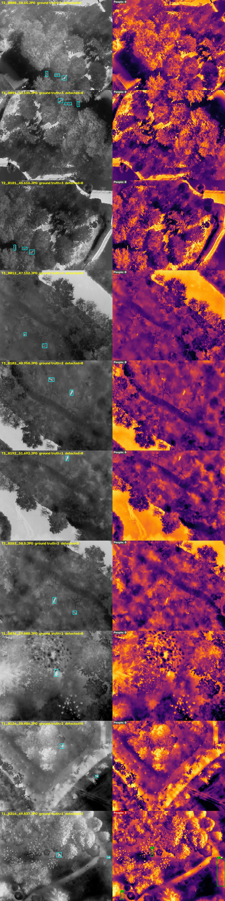

# InfraVision results

Status on 2026-10-29: the full pipeline runs end to end on CPU, but **none of
the three models has been trained on its target data yet** (that needs a GPU,
see `notebooks/train_colab.ipynb`). The numbers below are the *starting
point*: baselines and the older models that were already in the repo. Re-run
the commands at the bottom after Colab training to fill in the real numbers.

All numbers come from `docs/results/metrics.json` and the commands listed at
the end. CPU: 4 threads, no GPU.

## Detection: YOLO on POP (primary dataset)

Model: `human_detection/runs/thermal/colab_resumed/weights/best.pt`, YOLO11s
trained on **FLIR street-level** thermal, not on POP. POP val, flights
F13-F16, 200 evenly spaced frames, 597 people, IoU 0.5.

| imgsz | tiling | mAP@0.5 | precision | recall | s / image |
|---|---|---|---|---|---|
| 640 | none | 0.013 | 0.26 | 0.010 | 0.14 |
| 640 | 2x2 | 0.036 | 0.18 | 0.049 | 0.62 |
| **1024 (config default)** | none | **0.037** | **0.34** | **0.040** | 0.28 |
| 1024 | 2x2 | 0.065 | 0.12 | 0.089 | 1.31 |
| 1280 | none | 0.043 | 0.25 | 0.047 | 0.38 |
| 1280 | 2x2 | 0.043 | 0.06 | 0.085 | 2.28 |

Precision and recall at conf 0.25. Recall by person size (box side) at
1024 / 2x2 tiles: 16-32 px 0.025, 32-64 px 0.12, 64+ px 0.03.

What this says: the FLIR model does not transfer to POP's drone view (people
are ~40 px seen from 30-55 m above). A larger input and tiling help a little,
which confirms small objects are the problem, but the real fix is training on
POP. The config keeps imgsz 1024 and no tiling until the POP model exists;
re-run the size/tiling sweep then, since tiling may help it more.

## Super-resolution: EDSR x2 on POP (primary dataset)

100 fixed 192x192 crops from POP val (F13-F16), degraded with the training
recipe (blur, x2 down, bicubic up, noise, JPEG); scored against the clean crop.

| method | PSNR (dB) | SSIM |
|---|---|---|
| bicubic (baseline) | **43.02** | **0.966** |
| EDSR, old checkpoint `SR/checkpoints/ssim_residual/…epoch_10.pth` | 40.69 | 0.964 |

The old checkpoint was trained on other data and is *worse than bicubic* on
POP. A 2-epoch CPU preview run on POP crops already matched bicubic
(42.84 vs 42.83 dB), so POP training on Colab should beat it.

## Colorizer: thermal to RGB (synthetic set)

**Synthetic set**: `data/paired_disaster`, 80 val pairs (LLVIP thermal + real
LLVIP RGB; the smoke/fog/dust/dark variants are synthetic but scoring uses
the clean RGB). Not POP: POP has no RGB.

| method | PSNR (dB) | SSIM |
|---|---|---|
| grey thermal copied to 3 channels (baseline) | 9.25 | 0.196 |
| false-colour map, inferno (baseline, what the demo shows now) | 9.06 | 0.209 |
| trained colorizer | *not trained yet* | |

## Qualitative: 10 POP test frames



Left: thermal input with the **ground-truth** people in cyan. Right: the fused
output (pre-enhance, EDSR x2, false-colour map, model boxes in green with
confidence, people count). Frames are spread evenly over test flights T1-T3.

Visual check (done by eye on all 10 rows):
- Box alignment after the x2 upscale is correct: boxes sit where the model
  fired, on the same spot in both panels (also covered by
  `tests/test_fusion.py`).
- No colour artifacts or tile seams from tiled SR.
- Detection is the weak part: most real people are missed and some boxes are
  on warm ground or bushes, as the numbers above predict.

## CPU timings (1280x1024 POP frame, mean of 3)

| stage | full (x2 SR) s | fast (x1) s |
|---|---|---|
| pre-enhance (CLAHE + denoise) | 0.99 | 1.03 |
| super-resolution | 44.69 | 11.26 |
| colorize | 0.01 | 0.00 |
| **branch A total** | 45.69 | 12.30 |
| **branch B: YOLO (parallel)** | 0.26 | 0.26 |
| fusion | 0.00 | 0.00 |
| **total** | **45.71** | **12.31** |

Branch B runs alongside branch A, so total ≈ branch A. A trained colorizer
will add a few seconds at its 640 px working size.

## Smoke training (all three models, CPU, 2 epochs)

`python -m infravision.train.smoke` finished OK for SR, the colorizer and
YOLO (tiny subsets, written to `checkpoints/smoke/`). It checks the code
paths only; the scores are meaningless.

## How to reproduce

```bash
python -m infravision.train.yolo eval  --split val --max_images 200 --json docs/results/yolo_val.json
python -m infravision.train.yolo small --split val --max_images 200 --sizes 640 1024 1280 --tiles 0 2 --json docs/results/yolo_small_objects.json
python -m infravision.evaluate --out docs/results    # SR, colorizer, grid, timings
python -m infravision.train.smoke
python -m pytest -q
```
